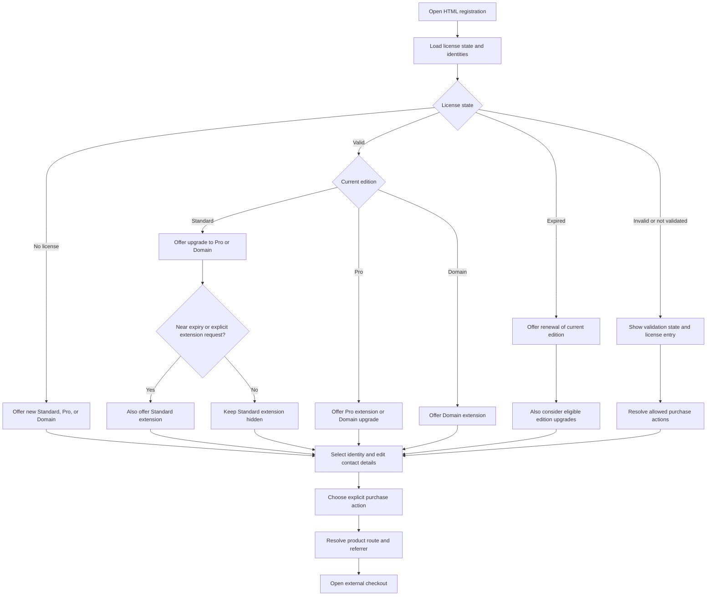
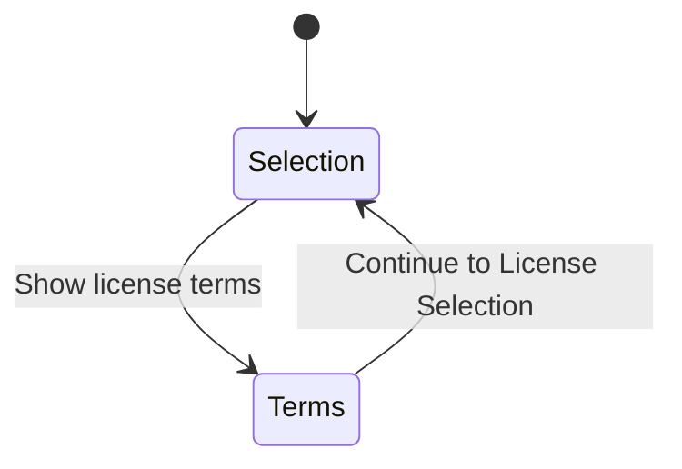
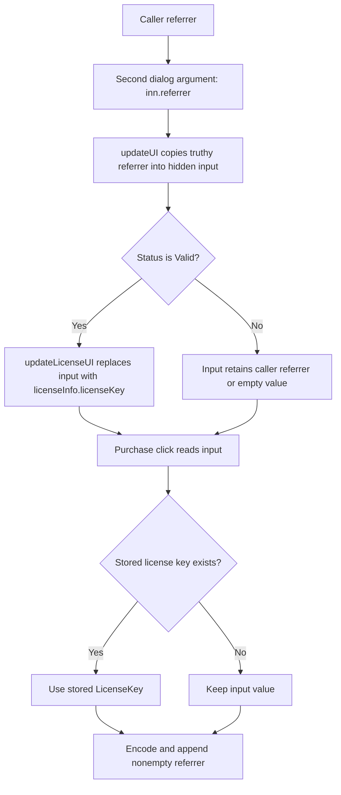

Original document takedn from SmartTemplates
E:\Dev\Mozilla\Dev\SmartTemplate\_Github\branches\ESR140\docs\issues\#445 - html registration

# HTML registration: business logic and implementation plan

## Scope and sources

Build a separate HTML registration page from scratch, initially with fixture data. Keep the existing dialog, callers, namespaces, scripts, and checkout behavior operational until the replacement is reviewed and explicitly adopted.

## Responsibilities

The registration page explains annual licensing, displays current license type and expiry, offers appropriate purchases, collects editable licensee details, and opens the shop. It also provides links to premium features and edition comparisons and an entry point for entering an existing license key.

License validation and entitlement calculation remain the background licenser's responsibility. The page consumes its result; it must not infer validity by parsing a key or checking the displayed date. The shop remains responsible for pricing and completing the transaction.

## Inputs and outputs

| Input | Meaning |
| --- | --- |
| License status | Valid, expired, empty, not validated, or another validation result supplied by the licenser |
| License edition | Legacy `keyType`: `0` Pro, `1` Domain, `2` Standard; use named editions inside the new model |
| License details | Existing key, licensed email, expiry date, validation description |
| Mail identities | Account identity identifiers, display name, full name, email, and default identity association |
| Secondary-identity preference | Whether the existing licensed secondary identity may be included |
| Originating feature | Feature that initiated the purchase flow, if any |
| Today | Explicit date input for repeatable expiry-window fixtures |
| Explicit extension request | User clicked the license date in Settings → Licenses; permits early extension independently of the default offer window |

Outputs are a display model with available actions, editable contact fields, and a checkout URL built from an explicitly selected action. Opening checkout, opening help, and opening license entry are separate effects.

## Licensing flows

This chart expresses the intended action model. Domain upgrades are a requirement whose checkout mapping still needs confirmation. Handling invalid and unvalidated keys is also a pending policy decision.

Maintainer clarification: there is no separate Domain upgrade product. The classic FastSpring shop requires manual duplication and pricing management for new product variants, so the replacement must use existing products rather than introduce new upgrade products. The exact existing-product destination for a change to Domain, particularly from an expired license, still needs confirmation.

### Intended action matrix

| Current license | Standard action | Pro action | Domain action |
| --- | --- | --- | --- |
| None | Buy | Buy | Buy |
| Valid Standard | Extend near expiry, or on explicit date-click request | Upgrade always offered | Upgrade: route to confirm |
| Expired Standard | Renew | Upgrade: expired entitlement to confirm | Upgrade: route to confirm |
| Valid Pro | No downgrade proposed | Extend | Upgrade: route to confirm |
| Expired Pro | No downgrade proposed | Renew | Upgrade: route to confirm |
| Valid Domain | No downgrade proposed | No downgrade proposed | Extend |
| Expired Domain | No downgrade proposed | No downgrade proposed | Renew |
| Invalid / not validated | Purchase policy to confirm | Purchase policy to confirm | Purchase policy to confirm |

Suppressing downgrades is a proposal, not an existing requirement. The legacy dialog leaves other-edition purchase buttons available. Confirm this UI policy before enforcing it.

Pro-to-Standard source review: there is no explicit downgrade action, dedicated product, or price-adjustment logic. For a valid Pro license, the still-visible Standard button selects the new Standard product (`instant/quickfoldersstandard`) and carries the current key as referrer. For an expired Pro license, a freshly opened dialog leaves the Standard button on the new Standard product (`instant/quickfoldersstandard`); its referrer remains the caller value unless changed. This is not proof that the shop supports discounted downgrades. The maintainer recalls wanting to discourage downgrade because of the substantial price difference; hiding Standard for existing Pro licensees remains a proposed policy pending confirmation.

For the new UI, identify the existing edition separately from validity: the prototype's summary reads "Standard license" alongside an "Expired" badge and expiry date. Use the same structure for valid licenses (edition, valid status, valid-until date), so expiry never makes a known license edition disappear. This is separate from the legacy registration caption, which does not name the edition.

### Rules observed in the current dialog

- Matching valid editions use the renewal product to extend. Matching expired editions use it to renew.
- Standard licenses show a Pro upgrade action whether valid or expired.
- Valid Standard hides its Standard row unless `expiryDate < today + 30 days`, using an ISO date comparison. Exactly 30 days is excluded by the current strict comparison. A replacement should define calendar-day and timezone semantics explicitly.
- In the registration controller itself, Pro and Domain extension actions have no corresponding 30-day restriction. This is distinct from default extension-offer visibility in Settings.
- The date is displayed in the user's locale. Expired status changes the date label and styling. Empty and not-validated states blank the label; other errors use the validation description.
- License-entry controls are hidden for a recognized valid license with an expiry date; they remain available for expired or missing licenses.
- Expanding annual-license information hides the contact form and purchase actions. Collapsing it restores them. Preserve access to the same information; the new layout need not copy this interaction.
- Feature information links to `https://quickfolders.org/premium.html`; comparison adds `#featureComparison`.

### Early extension through Settings (maintainer-confirmed)

The planned date-click action in Settings → Licenses will provide an explicit request to extend a Standard or Pro license, including well before expiry. QuickFolders does not currently implement this action; the maintainer is open to adding it. By default, the extension option is shown only shortly before expiry; that visibility window is a prompt policy, not a restriction on eligibility to extend. Standard licensees must always retain the upgrade path. The maintainer confirmed this intent, not a specific day count.

Code inspection finds to verify the default threshold(s):

| Location | Actual comparison | Boundary behavior |
| --- | --- | --- |
| Settings, `html\options.js`, valid-license branch | `expiryDate < ISODate(today + 30 days)` | Strictly before the computed 30-day date |
| Registration, `chrome\content\quickfolders-register-dlg.js`, valid Standard branch | `expiryDate < ISODate(today + 30 days)` | Strictly before the computed 30-day date |

Both compute the future date with local `setDate()` and then take the UTC date through `toISOString()`. These are the exact source comparisons, not guarantees of an elapsed-hour boundary. With aligned calendar dates, Settings can offer extension at 30 or 31 days remaining while registration still hides the Standard extension row. Preserve this distinction in current-behavior fixtures; choosing a common threshold for the replacement is a separate decision.

The replacement must preserve this explicit early-extension entry point. Model the request separately from the originating feature, for example as `intent: "extend"`. For valid Standard, an explicit extension request reveals the Standard extension action even outside the default window, alongside the Pro upgrade action. Extension still uses the edition's renewal product and passes the previous key as referrer.

SmartTemplates historical source caveat (not current QuickFolders behavior): before the HTML handoff was implemented, `showExtensionButton()` relabeled the Settings purchase button to Extend for valid Pro/Domain licenses, but called the legacy dialog for Standard without a force flag. The implemented HTML path now passes `intent: "extend"` for Standard date-clicks and Settings buttons labeled Extend. The confirmed behavior below supersedes that earlier gap; verify it end to end in Thunderbird.

### Settings license action priority (maintainer-confirmed)

For existing Domain holders, place a small-font additional-seats link immediately beneath the Domain plan description, above the purchase-action area. Maintainer-confirmed fulfillment URL: `http://sites.fastspring.com/quickfolders/product/quickfolders_domainseat`. This purchases additional seats during the existing license term; it is separate from renewal. Domain coverage requires at least one configured mail account whose email ends in the registered domain, within the purchased seats. A separate personal Pro license can be useful where that company account cannot be configured, for example at home. Do not imply that all Domain holders need an additional Pro license. Seat counts are contractual and company-managed, not directly enforced by the add-on.

For a fresh valid Standard license opened through Upgrade to Pro, show only Pro and Domain purchase panels. Hide Standard entirely while its extension action is date-gated; do not show a disabled Current edition button or an explanatory Standard panel. The maintainer prefers the simpler two-panel layout. Remove the alternate explanatory Standard panel and its comparison/close controls from the review prototype as well. Standard is shown only for an actionable purchase, extension, or renewal. Near expiry, Settings switches its single action from Upgrade to Pro to Extend License; that explicit extension entry point must reveal the Standard extension panel as described above.

Domain renewal/extension must highlight the Domain action, following the legacy XHTML behavior. Never highlight Buy Pro for an existing Domain holder: accidental Pro purchases instead of Domain renewal are a recurring maintainer-reported problem. Keep Standard hidden for recognized Domain licenses. Buy Pro may remain as a secondary, unhighlighted new personal-license purchase with a clear warning: it does not renew Domain, Domain may already cover the purchaser, and replacing Domain with Pro is a downgrade in user coverage. Always label the Domain action Renew Domain, including before expiry; do not use Extend Domain in user-facing labels. This changes the wording, not the renewal product or remaining-time entitlement. Verify both expired Domain renewal and valid Domain extension in the final build; see the required check in [test matrix](test-matrix.md).

Settings → Licenses displays at most one purchase action beside the status messages. Do not show Extend License and Upgrade to Pro simultaneously in Settings. Apply this rule to QuickFolders as well, which also offers Standard and Pro licenses; the QuickFolders implementation has not been verified here.

| Current license | Default Settings action |
| --- | --- |
| Valid Standard, outside the Settings extension window | Upgrade to Pro |
| Valid Standard, within the Settings extension window | Extend License; takes precedence over Upgrade to Pro |
| Valid Pro or Domain, within the Settings extension window | Extend License |
| Valid Pro or Domain, outside the Settings extension window | No action button; status messages use the full available width |
| Expired recognized license | Renew License |
| Missing or invalid license | Buy License |

Use the exact Settings date comparison documented above for the extension window. The proposed valid-date click adds the early-extension behavior described above. The registration page may offer multiple eligible actions, including Standard extension and Pro upgrade together; the single-action rule applies to Settings.

Keep status messages grouped to the left of the action. If the action wraps beneath the messages, center it. Latest News and Release Notes remain left-aligned in the Updates section.

## Between-tab navigation contract

Maintainer-approved interaction contract implemented in SmartTemplates on 2026-11-16. Adapt it for QuickFolders; the table includes SmartTemplates entry points and is a migration reference, not a record of existing QuickFolders callers. See the QuickFolders trigger trace below. The registration page is a Thunderbird tab rather than a floating dialog, so Settings and registration hand control to each other instead of accumulating tabs.

Design intent: registration proceeds through connected add-on pages inside Thunderbird, with cohesive navigation between license selection and Settings. Checkout is a deliberate boundary: the web shop opens outside Thunderbird in the user's default browser. The interface should make that handoff clear. Do not embed the shop in a Thunderbird tab or frame when replicating this conversion. The maintainer chose the external browser to avoid potential password-manager, checkout, and fulfillment problems in Thunderbird's embedded browsing environment. This is an intentional product decision, not a temporary implementation limitation.

### Entry points and destinations

| Starting page and action | Destination | Source-page behavior | Context passed |
| --- | --- | --- | --- |
| Composer notification bubble: Buy, Renew, or Upgrade license action | Modern HTML registration tab via the shared background `openRegistrationTab()` helper | Keep the composer open; reuse an existing registration tab when present | Pro and Standard feature identifiers joined with `\|` as the originating feature; no legacy notification bridge |
| Installation/update splash: Extend, Renew, Upgrade and renewal/upgrade promotional icons | Modern HTML registration tab through the shared background request | Close the splash only after a valid destination tab ID is returned; retain it on failure | `feature=landing-install` or `feature=landing-update`; explicit Extend actions also pass `intent=extend` |
| Template category-limit warning, both background and legacy menus | Modern HTML registration tab via the shared background helper | Keep the initiating Thunderbird window open | `feature=MAX_STANDARD_CATEGORIES`; legacy chrome uses the existing background bridge |
| General message dialog: license action | Modern HTML registration tab through the shared background request | Preserve the existing message-dialog behavior | Original `addonfeatures` value forwarded as `feature` |
| Test menu: Legacy License Registration | Original XHTML registration its legacy handler `QuickFolders.Interface.showLicenseDialog` | Retain the emergency fallback | Only the test-menu entry uses `messenger.Utilities.showXhtmlPage("chrome://quickfolders/content/register.xhtml")`; normal callers must not invoke the XHTML route |
| Settings → Licenses: Buy, Renew, Upgrade, or Extend button | New HTML registration tab, selection view | Close the initiating Settings tab only after the destination opens successfully | `feature=licenseTab`; also `intent=extend` when the button is labeled Extend |
| Settings → Licenses: click a valid Standard license date | New HTML registration tab, selection view with Standard extension available even outside its prompt window | Same successful-open-before-close rule | `feature=licenseTab&intent=extend` |
| Settings → Licenses: click a valid Pro/Domain license date | Remain in Settings and reveal/relabel its Extend button | No tab handoff until the user clicks that button | The subsequent button click passes extension intent |
| HTML registration: Enter license key… | Settings on its Licenses page, in `licenseKey` mode | Close the initiating registration tab only after Settings opens successfully | Existing `openPrefs` request with `page: "licenseKey"`, resulting in `mode=licenseKey` |
| Test menu: New registration tab | New HTML registration tab, selection view | Leave the Thunderbird window and other tabs open | No purchase feature or extension intent by default |
| HTML registration: purchase card | Appropriate product in the default external browser | Keep registration open, retain editable contact details, and show the dismissible checkout guidance beneath the cards | Contact details and the action-specific referrer described below |

The key-entry handoff assumes the user already has a key, usually received by email. Leaving registration open beside Settings can invite an unnecessary second order. Key entry and validation therefore remain in Settings; do not duplicate that workflow in registration. Settings focuses and highlights the key field in `licenseKey` mode. Validation continues to use the existing license handler and persistence behavior.

### Reuse, success, and failure rules

1. Resolve the destination with `runtime.getURL()` in the background context. Do not derive an internal page URL from the package `rootURI`, which can yield a disallowed `jar:` URL in an installed XPI.
2. Query for an existing destination tab by the page's base URL, including its query-string variants. If found, activate it and update its URL with the current mode, feature, and intent; otherwise create an active tab. Reusing registration must not retain a previous synthetic `scenario=` parameter or an unrelated old feature/intent.
3. Await the create/update operation and return its Tab object through the handled runtime request. The initiating page must receive a valid numeric destination tab ID before attempting to close itself. Here, successful open means the tabs API accepted creation/navigation; it is not a claim that every destination resource has finished loading.
4. Close only the initiating tab, using the ID obtained from `tabs.getCurrent()` before navigation. Never close the destination if the IDs match; never close all Settings/registration tabs or unrelated Thunderbird tabs. If the source ID is unavailable, leave it open.
5. If opening fails, rejects, or returns no valid destination ID, leave the source open and usable. Registration displays its existing Settings-open error; Settings currently logs the registration-open failure and re-enables its purchase button. If closing the source fails after the destination opened, retain the destination and tolerate both tabs rather than undoing the successful navigation.
6. Tab closure does not accept terms, purchase anything, clear a key, or change a license. Do not assume transient contact-field edits are transferred between registration and Settings. Authoritative license/account state is read again when a registration page opens; an existing registration tab also refreshes when it regains focus while retaining its contact edits.

### Background/API boundary and migration scope

Settings calls the direct `openRegistrationTab` runtime handler. It forwards `feature` and the explicit `extend` intent to `html/registration/open-tab.mjs`; the background resolves the extension URL and opens/reuses the tab. `openRegistrationFromSettings()` waits for that result before closing Settings. Registration's `openLicenseSettings()` uses the existing `openPrefs` runtime handler, which now returns the created/updated Settings Tab before registration closes. Runtime listeners stay synchronous for unhandled messages and return a Promise only for handled work.

The Test menu uses its existing menu-command/background transport to reach the same registration opener. No new notification listener is introduced. The original `register.xhtml` and its controller remain unchanged, and other legacy registration entry points still use that dialog until individually migrated. Do not redirect every old caller as an incidental consequence of the Settings migration.

### Cross-add-on acceptance checks

- Buy/Renew from Settings opens registration and closes just the source Settings tab.
- A pre-existing registration tab is reused, receives the latest parameters, and starts in selection view.
- Explicit early extension remains available for every supported personal edition, even before the usual prompt window; quickFilters must not acquire a Standard edition through shared code.
- Enter license key opens/reuses Settings, selects Licenses, focuses/highlights the key field, and closes registration.
- Repeating the round trip does not accumulate Settings/registration tabs or trigger any automatic order.
- Failed destination opening leaves the source available. No valid target ID means no source closure.
- Purchase cards leave registration open after external checkout opens; switching products should start from the relevant registration card to preserve entitlement parameters.

Automated tests cover the tab API result/order checks, reuse, feature/intent transport, and failure cases. These are not substitutes for the outstanding full license-state round in Thunderbird and the shop; record manual outcomes in [the test matrix](test-matrix.md).

## Two registration views and toggle behavior

Maintainer-confirmed: every newly opened dialog starts in the shopping/selection view, regardless of license status. This view choice is independent of the license-state action matrix.

| View | Visible content | Toggle label and appearance |
| --- | --- | --- |
| Shopping / license selection (initial) | Shared header and introduction, account selector, editable contact fields, applicable purchase links/buttons | `licenseTerms.show`: "Show license terms"; dark gray button |
| License terms | Shared header and introduction, annual-license explanation, premium-feature and comparison links, updates/expiry explanation, pricing explanation; account/contact form and purchase actions hidden | `licenseTerms.hide`: "🡇 Continue to License Selection 🡇"; red button through the `continue` class |

The current toggle is a reversible view switch, not an acceptance checkbox, checkout step, or requirement to read terms before shopping. It does not change the selected identity, edited contact values, license state, or referrer. The controller only hides and reveals the existing elements, so their values survive a round trip. The top status/date and license-entry area remain outside the switched content.

### Hover feedback and diagonal hatching

The supplied screenshots illustrate the existing feedback. In `quickfolders-register.css`, `#licenseTermSwitcher:hover` applies both a dashed outline and a repeating diagonal background. The gradient runs at 135 degrees, with alternating six-pixel bands (`#606dbc01` and `#46529812`). Its extent follows the switcher container: a shallow strip around the button in selection view, and the entire terms area plus its button in terms view.

The switcher container uses `pointer-events: none`; the toggle, its links, and `.link` descendants restore `pointer-events: auto`. This deliberately makes the decoration react when interactive descendants are hovered rather than remain active over the whole empty panel. Hovering an eligible link inside the terms container can also activate the ancestor's hover styling; it is not exclusively a button effect.

The gray toggle darkens on hover; the red Continue toggle becomes brighter red. The controller calls `window.sizeToContent()` after switching where available, so the legacy dialog may resize to fit the terms view. The HTML prototype should retain the two views and demonstrate the hatching interaction before any redesign is adopted. Exact XUL sizing is not a requirement for the new page.

### Terms content to review

The screenshots and current strings group the content into Annual License, Updates, and Pricing. They cover premium entitlement, personal/email-bound licensing, using multiple clients and additional addresses, post-expiry behavior, the external shop, and variable pricing.

Maintainer clarification: existing terms, especially descriptions of "premium features", may no longer match current internal behavior. Treat them as draft copy, not an authoritative entitlement specification. Review and verify them separately for SmartTemplates, QuickFolders, and quickFilters before shipping a replacement. Shared terminology does not imply identical feature restrictions, trial behavior, or post-expiry access across add-ons. Historical shop descriptions are not sufficient to resolve those questions.

For each add-on, establish what Standard (where available), Pro, trial, and expired states actually permit; distinguish temporary test access, usage limits, exclusive features, notifications, and any grace period. Trace the relevant enforcement code and verify uncertain cases at runtime, then write clear terms matching those findings. Record unverified claims explicitly rather than silently carrying old wording into the new UI.

Review proposals, not yet approved copy changes:

- Distinguish license duration, access to updates, and access to premium features after expiry; avoid suggesting that add-on updates stop when a key expires.
- Explain Standard versus Pro and Domain clearly, including the difference between testing premium features and unrestricted access. The current introduction says "two licenses" while a Domain purchase option also exists.
- Clarify that additional addresses do not each require a personal license, while the configured licensed address still matters; distinguish this from Domain coverage and seats.
- Keep prices and current discounts in the shop, explaining that country, tax, edition, and existing-license eligibility affect the result.
- Preserve useful comparison/help links and the clear route back to selection. Keep Terms and Continue keyboard-operable, expose the expanded/view state accessibly, and provide focus feedback without relying on hatching alone.

Prototype checks: always open in selection view; switch both directions with mouse and keyboard; preserve edited contact data; keep the header/status stable; verify hatching extent and interactive-descendant hover behavior in both views. Verify the terms remain readable at narrow widths and with reduced motion enabled.

## Caption panel and existing copy

The top row consists of three independent areas: product caption, license status/date, and license-entry controls. In the SmartTemplates registration source, the product caption is always `getQuickFolders` ("QuickFolders Licenses") and the window title is always `licenseWindow.title` (also "QuickFolders Pro License"). Neither is changed by edition. The changing caption is the middle status label, `licenseDateLabel`.

| Initial license state | Middle label | Date | License-entry controls |
| --- | --- | --- | --- |
| Valid, with expiry | `label.licenseValid`: "Your license is valid until:" | Locale-formatted expiry | Hidden |
| Expired, with expiry | `licenseValidation.expiredDate`: "Your license expired on:" | Locale-formatted expiry | Shown |
| Empty | A single blank space | Hidden if no expiry | Shown |
| NotValidated | A single blank space | Hidden if no expiry | Shown |
| Other validation result | Background `description` followed by `:` | Shown only if expiry exists | Shown |

These are initial-load observations; the legacy updater does not restore every default when status changes. Valid status relies on the original localized label rather than assigning it again. Expired status adds the `expired` class to `LicenseTerm`, giving a white-on-purple gradient and an opacity animation with a five-second delay and three-second cycle. That class is not removed by subsequent updates. The prototype should render each state explicitly rather than preserve these stale-state effects.

The current licenser descriptions for error states are English strings such as "Invalid", "Mail Not Configured", and "Mail Different". Displaying `description` is existing behavior, not evidence that these are localized UI messages. Check actual background output in runtime fixtures.

Use `_locales/en/messages.json` as the starting copy source, especially `getQuickFolders`, `label.licenseValid`, `licenseValidation.expiredDate`, `label.haveLicense`, `enterLicenseKey.*`, `licenseTypes`, `intro`, `testDriveS`, `yearlyLicense.*`, `updates.*`, `updatesExpiry`, `pricing.*`, `licenseComparison`, `licenseTerms.*`, and `buy*License.*`. Purchase labels already exist under `notification.premium.btn.*` for renew, extend, and upgrade. Keep message keys associated with the prototype copy so live localization can follow without translating legacy helper namespaces. You can reuse most entities from 
E:\Dev\Mozilla\Dev\SmartTemplate\_Github\branches\ESR140\_locales\en\messages.json
which are namespaced with "register."

The maintainer's implementation decision is to use the add-on-neutral `registration.*` namespace for the independent page. Add these entities to the English catalog only at this stage, recording each adapted legacy entity ID in its `description`. Leave original entities and other locales unchanged. This separates the two UIs for eventual XHTML retirement while keeping the new namespace transferable across add-ons. Resolve `{+extensionName}` through the shared formatter and supply the first-release year from add-on metadata. Shared keys do not require identical feature or licensing claims across add-ons; review those per product. This specification does not authorize changing other repositories.

The two screenshot references embedded in [the description](description.md) are visual starting points. Runtime captures of the scenarios below should settle any differences between the screenshots and this checkout's source. The prototype may display edition explicitly as an improvement; the current top caption does not.

The live [feature comparison](https://quickfolders.org/premium.html#featureComparison) was read on 2026-11-15. It compares Unlicensed, Standard, and Pro, followed by a separate "Current trial and license restrictions" explanation distinguishing entitlements from actual enforcement and reminders. This is useful context for reviewing the terms copy; it still needs reconciliation with the add-on code. The prototype already links directly to this table via `#featureComparison`. Keep the comparison on the support site rather than duplicating its full table in registration, where it could drift out of date. The maintainer prefers the existing thick Unicode `🡇` arrows on the terms toggle.

## QuickFolders registration triggers: current source trace

These are current legacy entry points, not evidence that the new HTML registration tab already exists. A restricted-feature warning opens registration only when the user selects its license button; merely using a feature does not automatically open the dialog. `popupRestrictedFeature` suppresses its warning when the existing license covers the requested level, increments a per-feature usage preference when possible, and passes the feature name to the dialog when the button is clicked. Availability of the notification box also affects whether a button is displayed.

| Trigger | Current referrer / behavior |
| --- | --- |
| Restricted-feature notification | The feature identifier supplied to `popupRestrictedFeature`; examples include `markFolderReadAndSkip`, `skipUnreadFolder`, `tabIcons`, `advancedTabProperties`, `tabSeparator`, `lineBreaks`, `bookmarks`, `pasteFolderEntries`, `save_config` and `load_config`. Find-folder actions pass their `actionType`; tab-limit warnings use `tabs>` plus the limit. The warning button calls the legacy interface directly. |
| Main toolbar menu registration | `mainPopup`, passed directly to the legacy interface. |
| Toolbar title with expired license | `mainLabelRenewal`, provided there is no news action taking priority. |
| Settings license button | `options_` plus the current options tab; Settings closes after sending the background message. |
| General message license button | The message URL `addonfeatures`, when present; otherwise `quickfolders-message`. The page sends this as `referrer` through the background registration handler. |
| Install or update splash registration control | `splashScreen`, via `messenger.Utilities.showLicenseDialog`; both use the same value. |
| Install splash extend, renew or upgrade control; update splash extend or renew control | Opens `register.xhtml` directly through `showXhtmlPage`, without a feature argument, and requests closing the splash. |

The registration controller can replace these referrers with a license key as described below, so a trigger identifier is not necessarily the final checkout referrer. The modern navigation contract above is a proposed migration target based on SmartTemplates; its composer and template-category examples are not QuickFolders triggers. Preserve the QuickFolders entry points and their feature identifiers when migrating, using the established notification bridge for legacy callers. The new date-click extension entry point is planned, not an existing trigger. Verify each migrated path in Thunderbird; this is a source trace, not a runtime test.

## Referrer transport and precedence

Source trace for the current QuickFolders dialog:

1. Legacy callers can invoke `QuickFolders.Interface.showLicenseDialog(featureName)` directly. For example, the main toolbar popup passes `mainPopup` in `chrome/content/scripts/qf-messenger.js`.
2. Settings sends `{ command: "showLicenseDialog", referrer: "options_" + QuickFolders.Options.currentOptionsTab }` from `html/options-interface.js`, then closes its window. The message page sends the same command with the URL `addonfeatures` as `referrer`, falling back to `quickfolders-message` when absent.
3. `qf-background.js` forwards `data.referrer` through `messenger.NotifyTools.notifyExperiment` as an event named `showLicenseDialog`. `chrome/content/quickfolders-tablistener.js` receives that event and calls `QuickFolders.Interface.showLicenseDialog(data.referrer)`.
4. The interface method creates `{ inn: { referrer: featureName, instance: QuickFolders }, out: null }` and opens `register.xhtml`, passing `QuickFolders` as the first extra argument and the parameter object as the second. The controller reads `window.arguments[1].inn.referrer`.

The controller then uses a hidden text input as mutable state:

`load()` calls `updateUI()` before `updateLicenseUI()`. Although `updateUI()` is declared async, its current body has no await, so it copies the referrer before the valid-license overwrite. Subsequent background updates call `updateLicenseUI()` again. Enabling the `premium.licenser` debug option exposes the input for inspection and editing.

`addRegisterEventListener` accepts and forwards the `renew` argument to `goPro` to select the product. At checkout, any stored `LicenseKey` takes precedence over the hidden field for every purchase, including expired licenses and cross-edition purchases. Only when no key exists does the caller referrer supply attribution. The selected value is encoded as a query parameter once. The message page passes `addonfeatures` as the caller referrer when provided.

For the new model, keep `originatingFeature` and `previousLicenseKey` separate and always choose the existing key first: the classic shop has only one referrer parameter. Do not fall back to a feature when an existing key is available.

## Identity and contact rules

Maintainer-confirmed edition availability: SmartTemplates and QuickFolders offer Standard, Pro, and Domain. quickFilters offers Pro and Domain, with no Standard edition. Shared page configuration must control both available cards and edition names in explanatory copy; do not display Standard in quickFilters.

The prototype provides a visible email hint ("Your personal license works across multiple devices") and a click/keyboard-operated information flyout beside the email label. Its Standard/Pro explanation ties personal use to the licensed address configured as an account's default identity on each device. Its separate Domain explanation requires an address belonging to the licensed domain. For quickFilters, the personal-license heading must mention Pro only. This describes the normal personal-license setup; the existing secondary-identity preference remains an advanced exception and should not be confused with the default guidance. The flyout closes with its close button, Escape (restoring focus to the trigger), an outside click, or switching to terms.

The current dialog lists each account's default identity. If no default exists, it lists that account's identities instead. Identities without email addresses are omitted. With `licenser.forceSecondaryIdentity` enabled, the first secondary identity matching the licensed email is additionally included. The first resulting item is selected, rather than automatically selecting the licensed email.

Selecting an identity populates editable email, first name, and last name. Legacy name parsing removes parenthesized text, trims whitespace, and takes the first and last space-separated tokens; middle names are discarded. Preserve the ability to edit all fields. Better name handling and preferential selection of the licensed identity are proposals to review, not requirements inferred from the old code.

The replacement must handle no eligible identities without crashing. Fixture mode should include that state, Unicode names, multi-part names, secondary identities, and manual edits. Decide whether an empty identity list permits manual checkout before live integration.

## Checkout contract

All current routes share `https://sites.fastspring.com/quickfolders/`:

| Action | Route suffix recorded in source |
| --- | --- |
| Buy Pro | `instant/quickfolders` |
| Renew or extend Pro | `instant/quickfoldersrenew` |
| Buy Standard |  `instant/quickfoldersstandard` |
| Renew or extend Standard | `instant/quickfoldersstdrenewal` |
| Buy Domain | `instant/quickfoldersdomain` |
| Renew or extend Domain |  `instant/quickfoldersdomainrenewal` |
| Upgrade Standard to Pro | `product/quickfoldersupgrade` |
| Upgrade to Domain | No separate product exists; confirm which existing Domain route applies |

### Confirmed product roles

The maintainer confirmed that buying Standard and renewing Standard use different products. Renewal and extension share the same product within each edition:

| Role | Active FastSpring product name | Legacy URL candidate |
| --- | --- | --- |
| Buy Standard | QuickFolders Standard | `instant/quickfoldersstandard` |
| Renew or extend Standard | QuickFolders Renewal | `instant/quickfoldersstdrenewal` |
| Buy Pro | QuickFolders Pro | `instant/quickfolders` |
| Renew or extend Pro | QuickFolderss Pro Renewal | `instant/quickfoldersrenew` |
| Upgrade Standard to Pro | QuickFolders Pro Upgrade | `product/quickfoldersupgrade` |
| Buy Domain | QuickFolders Annual Domain License | `instant/quickfoldersdomain` |
| Renew or extend Domain | QuickFolders Domain Annual Renewal | `instant/quickfoldersdomainrenewal` |

Product names and the Standard/Pro renewal roles are confirmed; the URL candidates remain copied from the controller. The inventory lists names, not URL identifiers, so it does not independently verify these mappings. In particular, the product name "SmartTemplate Renewal" refers to Standard renewal, despite not containing "Standard".

Historical Domain copy describes a base domain product plus a separately specified user count, a minimum of five users, a matching email domain on each installation, and manually issued keys delivered within 24–48 hours. These details explain possible seat products but must be confirmed before becoming current UI promises. 

Historical general copy may still references QuickFolders, mozdev, and addons.mozilla.org; use the existing localization catalog as the UI starting point rather than copying that text wholesale. Do not hard-code prices from the shop files.

Contact parameters are `contact_fname`, `contact_lname`, and `contact_email`. The attribution/entitlement parameter is `referrer`:

- No existing license key: originating feature, when supplied.
- Any existing license key, expired or valid: use the key for every purchase, ahead of any feature attribution.
- Omit an absent referrer; do not replace a required license referrer with a feature name.

Build URLs with `URL` and `URLSearchParams`, supplying raw values exactly once. The legacy code concatenates contact values directly and sometimes applies `encodeURI` to a license key. That can mishandle reserved characters and should not become a compatibility requirement. Keep real keys and personal data out of fixtures and diagnostic logs.

The legacy dialog opens checkout in the browser and closes itself immediately. The HTML page deliberately stays open after external checkout opens, retains contact edits, and shows checkout guidance beneath the purchase cards. A failed open leaves the page usable for another attempt. This differs from the Settings/registration handoffs, where the initiating tab closes only after a successful destination open, as specified above.

## Legacy discrepancies to resolve

1. `addRegisterEventListener` accepts a third renewal flag and passes it to `goPro`. The selected handler determines renewal routing; expiry alone does not force it.
2. In a freshly opened dialog, expired Standard changes the Pro handler to an upgrade but leaves Standard and Domain on their initial purchase handlers. Thus Standard currently selects the new Standard product rather than renewal; the new model should offer the intended Standard renewal explicitly and use action-specific routing.
3. Checkout now prioritizes any stored license key over the hidden feature referrer for all actions. The replacement needs one authoritative background snapshot and must retain that precedence.
4. The issue requires upgrades to Domain, and the maintainer confirms there is no separate upgrade product. Reuse an existing Domain product after confirming its eligibility rules; do not invent a product or assume a renewal URL grants upgrade eligibility.
5. Some route comments still say the product must be created; another comment reverses the Standard-to-Pro upgrade direction. Confirm routes independently of those comments before enabling checkout.
6. License updates mutate existing labels, classes, and hidden rows without fully resetting the view. The replacement should derive the complete view from each snapshot so state changes cannot leave stale actions.

## Independent implementation

Use a new directory for the HTML page, stylesheet, controller, and modules. Do not load legacy `QuickFolders` scripts or recreate their namespaces. Keep the old registration entry points unchanged while development proceeds.

- **Domain model:** pure functions derive actions from license state, determine identity choices, and construct checkout URLs. Inputs include the date and product configuration so fixtures remain deterministic.
- **View:** accessible HTML renders that model, contact fields, terms, status, and errors. Re-rendering preserves contact edits unless the user changes identity.
- **Fixture adapter:** supplies synthetic licenses and identities, exposes scenario selection, and previews checkout details without opening the shop.
- **Live adapter:** uses standard MailExtension APIs for identities and window/tab operations and direct runtime requests for background-owned license state and preferences. Keep listeners synchronous, returning a Promise only for handled requests. Verify exact APIs and minimum-version support during implementation.
- **Background boundary:** add only narrowly scoped handlers needed by the new page when live integration is ready. Do not add NotifyTools listeners or route existing callers to the new page during this phase.

Product configuration should hold edition availability, shop routes, help URLs, and localized message identifiers. This allows later reuse across add-ons without embedding QuickFolders assumptions throughout the view.

## Review and verification sequence

1. Review the action matrix and resolve Domain upgrade routing, expired upgrade entitlement, downgrade visibility, invalid-license behavior, and renewal-window boundaries.
2. Build a standalone static UI with synthetic scenarios for every matrix row. Include terms, license entry, account selection, and contact editing. Disable real checkout effects in fixture mode.
3. Implement and test the pure rules, especially the action/route matrix, referrer precedence, reserved-character encoding, expiry boundaries, and transitions between license states.
4. Add the live adapter behind a separate development entry point. Confirm shop routes and minimum-version APIs before enabling transactions.
5. Exercise the replacement in Thunderbird without changing the original dialog's callers. Then review localization in scope for each locale and accessibility, keyboard navigation, theme, and narrow-window behavior.
6. Switch existing entry points only in a later approved integration change. Update release documentation when the feature is prepared for release; no version or build-counter change is needed for this specification.

## Requested runtime checks and pending answers

No purchase is needed for these checks. Use generated test licenses with an address configured in the test profile. Open a fresh registration dialog for each state. Record the top caption/status/date, available purchase labels, and whether license entry is shown. For checkout checks, stop at the shop landing page and report the product path and whether `referrer` represents the feature or previous key; do not paste real keys or personal details.

| Test state | What it resolves |
| --- | --- |
| No key, opened from a known feature | Feature survives the caller path and reaches checkout |
| Valid Standard, expiry more than 30 days away | Hidden Standard row, Pro upgrade, top status |
| Valid Standard and valid Pro, more than 30 days away, date clicked in Settings → Licenses | Explicit early-extension path; Standard extension remains available alongside upgrade |
| Valid Standard, expiry 29 days away and exactly 30 days away | Extension visibility at the boundary |
| Valid Standard, expiry 31 and 32 days away | Verify both 30-day comparisons and their boundary behavior |
| Expired Standard | Standard renewal product and key referrer; Pro upgrade availability |
| Valid Pro, then expired Pro | Extend versus renew caption/action; Domain destination in each case |
| Valid Domain, then expired Domain | Domain extend versus renew, and top status styling |

Pending business answers:

- Domain: no separate upgrade product exists (confirmed). Which existing Domain destination should Standard/Pro holders use, and does expiry change this?
- Standard: buying uses SmartTemplate Standard; renewal and extension use SmartTemplate Renewal (confirmed). Default near-expiry prompting and explicit early extension through the Settings date are intentional (confirmed). Current QuickFolders Settings and registration both compare against today plus 30 days, using strict comparisons; Settings also has a debug override. Confirm the legacy URL mapping and implement the proposed date-click entry point.
- Domain seats: confirm whether existing checkout pages collect the seat count, the current minimum, and whether any of this needs to appear in the registration UI.
- Other proposals in the action matrix remain unconfirmed, including downgrade visibility and purchases from invalid/unvalidated states.

If the observed top caption changes by edition in a runtime test, capture that state: this QuickFolders registration controller only changes the status/date area. This may identify behavior elsewhere or a difference from another add-on.

### Purchase button wording (approved)

Registration cards use Renew License and Extend License; their edition heading supplies the product name. Standard and Pro use Extend License before expiry and Renew License after expiry. Domain uses Renew License both before and after expiry. Upgrade to Pro remains explicit. Test-case selector names retain edition names to identify the scenario.
